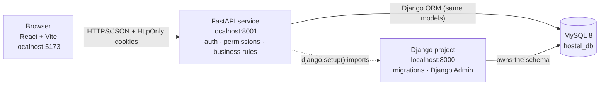
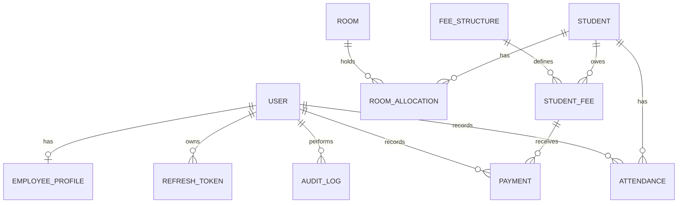

# Hostel Desk: Hostel Management System

A full-stack hostel administration application built with **Django**, **FastAPI**, **React** and **MySQL**.
Administrators run the whole hostel; employees get a focused desk with only the permissions they were granted.

> Status: developed and tested locally (see [Testing](#testing)). It has **not** been deployed, and it has **not**
> had a professional security review. Read [Production notes](#production-notes) before putting it on the internet.

## Features

| Area | What it does |
|---|---|
| **Authentication** | Email + password sign-in, short-lived JWT access token and rotating refresh token in HttpOnly cookies, CSRF protection, instant sign-out when an account is deactivated or its role/password changes |
| **Roles** | *Administrator* (everything) and *Employee* (only the permissions an administrator grants). Enforced on the server for every request |
| **Dashboard** | Role-specific; every number is calculated from the database. Bed meter, occupancy by block, money this month, attendance today, recent activity |
| **Page guidance** | Every page opens with a live summary row (counts, money, occupancy) and an "About this page" panel explaining the rules behind it |
| **Students** | Add, edit, search, filter by room/status, paginate, deactivate (history is kept, never deleted) |
| **Rooms** | Capacity, type, block, floor, rate; occupancy computed from allocations; closed rooms |
| **Allocations** | Allocate and transfer in database transactions with row locks, so a room can never be over-filled |
| **Fees & payments** | Fee structures, per-student fees, partial payments, balances, overdue tracking, receipts, duplicate-payment protection |
| **Attendance** | Daily roster entry (present / absent / leave), history, percentages, admin-only audited corrections |
| **Employees** | Create / edit / activate / deactivate, per-employee permissions, password reset |
| **Reports** | Registrations, occupancy, available rooms, fee collections, outstanding fees, attendance, with date filters and CSV export |
| **Audit log** | Important administrative actions are recorded (never including passwords) |
| **Django Admin** | At `/admin/` for administrators only |

Payments are **recorded manually**. No payment gateway is integrated.

## Technology stack

- **Django 5.2**: models, migrations (the single source of truth for the schema), Django Admin, password hashing
- **FastAPI**: REST API, Pydantic validation, JWT auth, Swagger UI, using Django's ORM
- **React 18 + Vite**, React Router, Axios, Context API, plain CSS, **Lucide** icons
- **MySQL 8**
- **Tests:** pytest + pytest-django + FastAPI TestClient; Vitest + React Testing Library

## Architecture



- **Django owns the schema.** Only `python manage.py migrate` creates or changes tables. FastAPI never creates tables.
- **FastAPI uses Django's ORM** by calling `django.setup()` at start-up (`backend/api/main.py`). The trade-off is that the two services share code and must be deployed together; the benefit is one set of models and no schema drift.
- Endpoints are plain `def` functions (FastAPI runs them in a thread pool) because the Django ORM is synchronous. `api/core/db.py` closes stale DB connections around each call.

### Authentication flow

1. `POST /api/v1/auth/login` checks the password with Django's `authenticate()` and sets three HttpOnly cookies: an **access JWT** (15 min), a **refresh token** (7 days, only its hash is stored), and a **CSRF token**.
2. On every request the API verifies the JWT signature and expiry, loads the user **from the database**, checks the account is active and that the token's `ver` equals the user's `token_version`. The role used for decisions is always the database role, never the one in the token and never one sent by React.
3. State-changing requests from the browser must repeat the CSRF token in an `X-CSRF-Token` header (double-submit check).
4. When the access token expires, Axios calls `/auth/refresh` once, which **rotates** the refresh token. Re-using an old refresh token signs the user out everywhere.
5. Deactivating an account, changing its role, or changing its password bumps `token_version`, so existing access tokens stop working immediately.
6. Logout revokes the refresh token and clears the cookies. (An already-issued access token stays valid until it expires, at most 15 minutes, unless the account is changed as in step 5.)

For Swagger UI / Postman only, `POST /api/v1/auth/token` returns a bearer token. Set `ENABLE_BEARER_TOKEN_ENDPOINT=False` in production.

### Role and permission matrix

| Capability | Administrator | Employee |
|---|:-:|:-:|
| Admin dashboard, reports, CSV export | ✅ | ❌ |
| Employee dashboard | ✅ | ✅ |
| Employees: create, edit, (de)activate, permissions, reset password | ✅ | ❌ |
| View students | ✅ | `students.view` |
| Create / edit / deactivate students | ✅ | ❌ |
| View rooms and availability | ✅ | `rooms.view` |
| Create / edit rooms, allocate, transfer | ✅ | ❌ |
| Fee structures, charge fees, **record payments** | ✅ | ❌ |
| View fees, payment history, receipts | ✅ | `fees.view` |
| Record attendance | ✅ | `attendance.record` |
| View attendance history and percentages | ✅ | `attendance.view` |
| Correct an existing attendance record | ✅ | ❌ |
| Django Admin (`/admin/`) | ✅ | ❌ |

Administrator accounts can only be created with `manage.py createsuperuser` or Django Admin. The employee endpoint always creates the `employee` role, whatever a client sends.

## Database design



Design rules worth knowing:

- **Money is `DECIMAL(10,2)`.** Paid amount, balance and fee status are *derived* from payments; occupancy is derived from allocations. Nothing that could drift is stored.
- **One active room per student** is enforced by the database. MySQL has no partial unique indexes, so `RoomAllocation.active_student_key` holds the student id while active and `NULL` afterwards, with a unique index on it.
- **One attendance row per student per day** (unique constraint). Corrections are admin-only and audited.
- **Duplicate payments**: a unique `idempotency_key` plus a unique `transaction_reference`; the API also locks the fee row while recording.
- History is protected: foreign keys use `PROTECT`; students and employees are deactivated, never deleted; payments are append-only.
- Check constraints (positive amounts, valid dates, only admins may be staff) need **MySQL 8.0.16+**.

## Project structure

```text
hostel-management-system/
├── backend/
│   ├── manage.py
│   ├── requirements.txt
│   ├── .env.example
│   ├── config/            Django settings and URLs
│   ├── common/            shared base model, validators, seed_demo command
│   ├── accounts/          custom User, EmployeeProfile, RefreshToken, AuditLog, permission codes
│   ├── students/  rooms/  fees/  attendance/     models + admin + migrations
│   ├── api/
│   │   ├── main.py        FastAPI app (django.setup(), CORS, routers)
│   │   ├── dependencies.py   current user, role/permission checks, CSRF
│   │   ├── core/          settings, JWT/cookies, errors, pagination, DB bridge
│   │   ├── schemas/       Pydantic request/response models (with examples)
│   │   ├── routers/       one file per module
│   │   └── services/      business logic (allocation, payments, reports ...)
│   └── tests/             pytest suite
├── frontend/
│   └── src/  api/ components/ context/ hooks/ layouts/ pages/ routes/ utils/ __tests__/
├── docs/screenshots/
├── .gitignore
└── README.md
```

## Interface design

The interface uses a navy sidebar, a blue action colour and an amber accent. Colours carry meaning: blue = records, teal = rooms, green = good/paid/present, amber = needs attention, red = problem/overdue/absent, violet = analytics. Icons come from Lucide and always sit beside text, never replace it. Pages collapse to a card layout on phones, and printing a receipt hides the navigation.

## Installation on Windows

These steps use your **existing Python installation** (no virtual environment) and VS Code. Commands work in
PowerShell or Command Prompt, run from the folder shown.

### 1. Check your tools

```text
python --version        (3.10 to 3.13; 3.12 recommended)
python -m pip --version
node --version          (Node 18+ ; LTS recommended)
npm --version
mysql --version         (MySQL 8.0.16 or newer)
```

If `mysql` is not recognised, install **MySQL Installer for Windows** (dev.mysql.com/downloads/installer), choose
*Server only*, keep port 3306 and run it as a Windows service. Check the service with `Get-Service *mysql*` and
start it from an Administrator terminal with `net start MySQL80` if needed.

### 2. Create the database and a dedicated user

```text
mysql -u root -p
```

```sql
CREATE DATABASE hostel_db CHARACTER SET utf8mb4 COLLATE utf8mb4_0900_ai_ci;
CREATE USER 'hostel_user'@'localhost' IDENTIFIED BY 'CHOOSE_A_STRONG_PASSWORD';
GRANT ALL PRIVILEGES ON hostel_db.* TO 'hostel_user'@'localhost';
GRANT ALL PRIVILEGES ON `test\_hostel\_db`.* TO 'hostel_user'@'localhost';
FLUSH PRIVILEGES;
EXIT;
```

Use your own password. The second grant lets the test-suite create a throw-away `test_hostel_db`.

### 3. Configure the backend

```text
cd backend
python -m pip install -r requirements.txt
copy .env.example .env
python -c "import secrets; print(secrets.token_urlsafe(64))"
```

Run the last command **twice**. Open `.env` (`code .env`) and set `DJANGO_SECRET_KEY` to the first value,
`JWT_SECRET` to the second (they must differ) and `DB_PASSWORD` to your database password. Never commit `.env`.

### 4. Create the tables and the first administrator

```text
python manage.py migrate
python manage.py createsuperuser
```

`createsuperuser` asks for an email and a password (typed hidden). Optionally add demo data for screenshots:

```text
python manage.py seed_demo
```

### 5. Start the services, each in its own terminal

| Terminal | Folder | Command | URL |
|---|---|---|---|
| 1: API | `backend` | `python -m uvicorn api.main:app --port 8001 --reload` | http://localhost:8001/docs |
| 2: Django Admin (optional) | `backend` | `python manage.py runserver 8000` | http://localhost:8000/admin/ |
| 3: React | `frontend` | `npm install` then `npm run dev` | http://localhost:5173 |

Create `frontend/.env` from `frontend/.env.example` (`copy .env.example .env`). **Use `localhost`, not `127.0.0.1`,
everywhere** so the browser treats the app and the API as the same site and sends the cookies.

### 6. Try it

1. Open http://localhost:5173 and sign in with the administrator you created.
2. Add rooms and students, allocate a room, charge a fee, record a payment, take attendance.
3. Under **Employees → Add employee** create an employee with some permissions, sign out, and sign in as them to
   see the restricted desk. Try opening `/admin/employees` as that employee: access is denied.

## Environment variables

`backend/.env`

| Variable | Purpose | Default |
|---|---|---|
| `DJANGO_SECRET_KEY` | Django signing key (required) | none |
| `DJANGO_DEBUG` | Debug mode, **False in production** | False |
| `DJANGO_ALLOWED_HOSTS` | Comma-separated host names | localhost,127.0.0.1 |
| `DJANGO_TIME_ZONE` | Time zone | Asia/Kolkata |
| `DB_NAME` `DB_USER` `DB_PASSWORD` `DB_HOST` `DB_PORT` | MySQL connection | none / localhost / 3306 |
| `DB_ENGINE` | `mysql` (default) or `sqlite` (tests only, for machines without MySQL) | mysql |
| `JWT_SECRET` | Signs access tokens, ≥ 32 chars, must differ from Django's key (required) | none |
| `ACCESS_TOKEN_MINUTES` / `REFRESH_TOKEN_DAYS` | Token lifetimes | 15 / 7 |
| `CORS_ALLOWED_ORIGINS` | Origins allowed to call the API (no `*`) | http://localhost:5173 |
| `COOKIE_SECURE` | Send cookies only over HTTPS | False (dev) |
| `COOKIE_SAMESITE` | `lax`, `strict` or `none` | lax |
| `COOKIE_DOMAIN` | Cookie domain when the app and API are on sibling subdomains | empty |
| `ENABLE_BEARER_TOKEN_ENDPOINT` | Swagger/Postman token endpoint, **False in production** | True |

`frontend/.env`: `VITE_API_BASE_URL` (default `http://localhost:8001/api/v1`).

## API reference

Interactive docs: **http://localhost:8001/docs** (Swagger UI) and `/redoc`. Errors always look like
`{"error": {"code", "message", "details"}}`. "Perm" means an employee holding that permission is also allowed.

| Method | Path | Who |
|---|---|---|
| GET | `/health` | public |
| POST | `/api/v1/auth/login` · `/refresh` · `/logout` | public / cookie |
| POST | `/api/v1/auth/token` | public, dev only (Swagger/Postman bearer) |
| GET | `/api/v1/auth/me` | signed in |
| POST | `/api/v1/auth/change-password` | signed in |
| GET | `/api/v1/dashboard/summary` | signed in (role-specific) |
| GET | `/api/v1/students` `/summary` `/{id}` | admin · `students.view` |
| POST/PUT | `/api/v1/students` `/{id}` | admin |
| PATCH | `/api/v1/students/{id}/status` | admin |
| GET | `/api/v1/rooms` `/summary` `/available` `/{id}` `/allocations` | admin · `rooms.view` |
| POST/PUT | `/api/v1/rooms` `/{id}` | admin |
| POST | `/api/v1/rooms/allocations` · `/allocations/{id}/transfer` | admin |
| GET | `/api/v1/fees` `/summary` `/pending` `/structures` `/{id}` `/payments` `/payments/{id}/receipt` | admin · `fees.view` |
| POST | `/api/v1/fees` · `/fees/structures` · `/fees/payments` | admin |
| GET | `/api/v1/attendance` `/roster` `/summary` | admin · `attendance.view` (roster also `attendance.record`) |
| POST | `/api/v1/attendance` | admin · `attendance.record` |
| PUT | `/api/v1/attendance/{id}` (correction, reason required) | admin |
| GET/POST/PUT/PATCH | `/api/v1/employees` ... `/{id}/status` · `/{id}/reset-password` | admin |
| GET | `/api/v1/reports/registrations` `/occupancy` `/fees` `/outstanding` `/attendance` (`?format=csv`) | admin |

List endpoints accept `page`, `page_size` (max 100), search/filter parameters and, where noted in Swagger, `ordering`.

### Testing in Swagger UI

1. Open http://localhost:8001/docs and click **Authorize**.
2. Enter your administrator **email as the username** and your password, then **Authorize**.
3. Expand any endpoint, click **Try it out**, and **Execute**. Use an employee's login to see 403 responses.

### Testing in Postman

1. `POST http://localhost:8001/api/v1/auth/token`, body type *x-www-form-urlencoded*, keys `username` (email) and `password`.
2. Copy `access_token` from the response.
3. On other requests, set *Authorization → Bearer Token* to that value. JSON bodies need `Content-Type: application/json`.
   Bearer requests do not need the CSRF header.

## Testing

```text
cd backend
python -m pytest
```

This uses a throw-away `test_hostel_db` on MySQL. With no MySQL available, run the suite on SQLite instead
(PowerShell: `$env:DB_ENGINE="sqlite"; python -m pytest`; Command Prompt: `set DB_ENGINE=sqlite` then `python -m pytest`).
Two concurrency tests need real row locks and are skipped on SQLite.

```text
cd frontend
npm test
```

The backend suite covers login (valid, invalid, inactive), token expiry/revocation, cookie + CSRF, refresh rotation and
reuse, administrator vs employee permissions on every restricted endpoint, student CRUD, search and pagination, room
capacity, allocation, transfer, **concurrent allocation and payment races**, fee validation, duplicate and over-payment
protection, attendance duplicates and corrections, employee lifecycle, reports/CSV and audit logging. The frontend suite
covers protected routes, role-aware navigation, the login form, student form validation, and a render test that opens every administrator and employee page with realistic data.

## Troubleshooting

| Symptom | Fix |
|---|---|
| `Missing required environment variable` | `backend/.env` missing or incomplete |
| `JWT_SECRET is missing or too short` | Set a 32+ character `JWT_SECRET` different from the Django key |
| `Access denied for user 'hostel_user'` | Wrong `DB_PASSWORD`, or the user was not created (step 2) |
| `Can't connect to MySQL server` | Start the MySQL service (`net start MySQL80`) |
| `pip` cannot build `mysqlclient` | `python -m pip install --upgrade pip` and retry; otherwise use PyMySQL (`pymysql.install_as_MySQLdb()` in `config/__init__.py`) |
| React shows "Cannot reach the server" | API not running, or `VITE_API_BASE_URL` wrong |
| Login works but you are signed out on the next click | You mixed `localhost` and `127.0.0.1`; use `localhost` for both |
| `403 csrf_failed` | Reload the page so a fresh CSRF token is issued |
| CORS error in the browser console | Add the exact React origin to `CORS_ALLOWED_ORIGINS` and restart the API |
| `InconsistentMigrationHistory` | `migrate` ran before the custom user model existed: drop and recreate the database, then migrate |
| Port already in use | Change the port in the command (and `VITE_API_BASE_URL` / `CORS_ALLOWED_ORIGINS` to match) |

## Production notes

This project is **ready to be prepared for** deployment, not deployed. Before going live you must at least:

- Serve React and the API over **HTTPS** (a reverse proxy such as nginx or Caddy); set `COOKIE_SECURE=True`.
- Set `DJANGO_DEBUG=False`, a real `DJANGO_ALLOWED_HOSTS`, and `CORS_ALLOWED_ORIGINS` to your exact front-end origin only.
- Set `ENABLE_BEARER_TOKEN_ENDPOINT=False`.
- Keep secrets in a secret manager or the host's environment, never in Git. Rotate `JWT_SECRET` if it leaks (everyone is signed out).
- Run uvicorn/gunicorn as a service, build the front end (`npm run build`) and serve `dist/`. If the app and API are on sibling subdomains, set `COOKIE_DOMAIN`.
- Use a least-privilege MySQL user, enable **automated backups** and test a restore.
- Add rate limiting for `/auth/login` at the proxy (there is no built-in login throttling), and monitor the audit log.
- Have the application reviewed by someone else, and run `python manage.py check --deploy`.

## Known limitations

- No login rate limiting or account lockout in the application itself.
- Logout cannot cancel an access token that was already issued; it expires within `ACCESS_TOKEN_MINUTES`.
- Student/room pickers load up to 100 records; very large hostels would need type-ahead search.
- Payments are manual entries; no gateway, refunds or reversals (corrections would be a new, documented workflow).
- The interface has been built to be responsive and accessible, but has not been through formal accessibility testing.

## Pushing to GitHub

```text
git init
git add .
git status
git commit -m "Initial commit: hostel management system"
git branch -M main
git remote add origin https://github.com/YOUR-USERNAME/hostel-management-system.git
git push -u origin main
```

Run `git status` before committing and confirm no `.env` file is listed. Add screenshots to `docs/screenshots/`.

## Screenshots

_Add screenshots here after running the app (login, administrator dashboard, rooms, attendance, receipt)._
